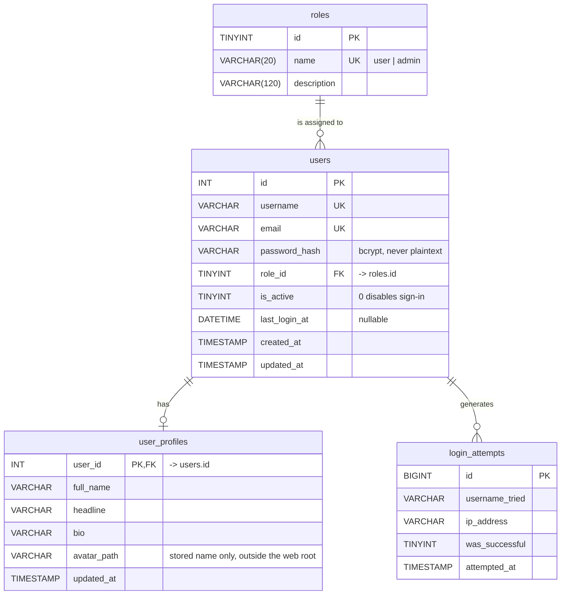

# Task 3 — Entity Relationship Diagram

Database: `apexplanet_users`



## Relationships

| From | To | Cardinality | Enforced by |
|---|---|---|---|
| `roles` | `users` | one role → many users | `fk_users_role` |
| `users` | `user_profiles` | one user → zero or one profile | `fk_profiles_user` |
| `users` | `login_attempts` | one user → many attempts | none (deliberate: see below) |

`user_profiles.user_id` is both the primary key and the foreign key, which is
what makes the relationship strictly one-to-one rather than one-to-many.

## Delete behaviour

- `users` → `user_profiles` is `ON DELETE CASCADE`. Removing an account removes
  its profile, so no orphan row is left behind. The test suite asserts this.
- `users` → `roles` is `ON DELETE RESTRICT`. A role that is still in use cannot
  be deleted out from under the accounts holding it.
- `login_attempts` has **no** foreign key on purpose. Security logs must survive
  the deletion of the account they describe; otherwise deleting a user erases the
  evidence that they tried to sign in. The username is stored as text for the
  same reason.

## Normalisation

### First normal form

Every column holds a single atomic value. There are no comma-separated lists:
a user's skills or roles would live in junction tables, not in one column.

### Second normal form

Every table uses a single-column surrogate primary key (`id`, or `user_id` for
the profile). With no composite key, the "every non-key column depends on the
whole key" rule cannot be violated. `roles.name` and `users.email` are
uniquely indexed because the application looks rows up by them.

### Third normal form

The table that would otherwise be easiest to get wrong is `users`. Storing the
role name there — `role = 'admin'` — would create a transitive dependency:

```
id  ->  role_id  ->  role_name
```

and any rename of a role would have to be propagated across every user row. So
`roles` is a lookup table and `users` carries only `role_id`. The suite checks
this directly by asserting that a `role` column does not exist on `users`.

`user_profiles` is split out for the same reason: biography and avatar data are
optional, wide, and change on a different schedule from account credentials.
Keeping them apart means a user row stays small and a profile update does not
dirty the authentication table.

### Denormalisation, and why

`roles.description` is the only convenience denormalisation, and it changes
essentially never. Everything that can change is normalised, because anything
that can change is exactly what drifts out of sync.

## Indexes

| Index | Table | Why |
|---|---|---|
| `uq_users_username` | users | login lookup, and the natural key |
| `uq_users_email` | users | login by email, and prevents duplicates |
| `idx_users_role` | users | filtering a list by role |
| `idx_attempts_user_time` | login_attempts | the throttle query, which counts recent failures for one identifier |
| `idx_attempts_ip_time` | login_attempts | the same count scoped to a source address |

## How this maps to the brief

The task asked for an ER diagram covering `users` and `roles`. Both are present
as first-class tables with the relationship enforced by a foreign key rather
than by convention, and `user_profiles` / `login_attempts` extend that to the
full feature set this task delivers: profile pictures and throttled sign-in.
