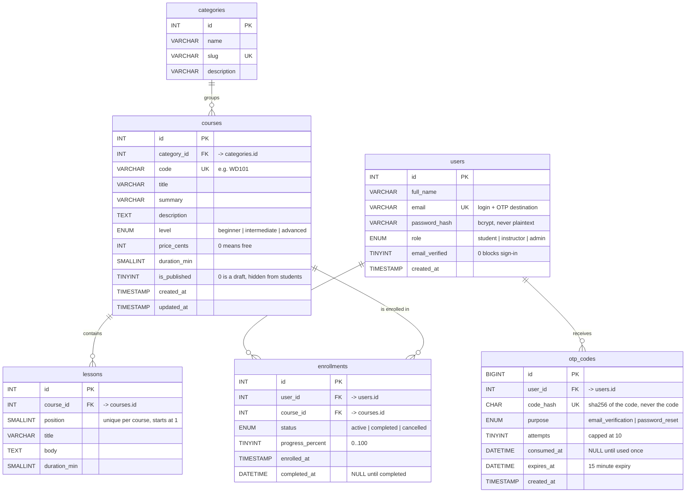

# Task 5 — Entity Relationship Diagram

Database: `apexplanet_lms`



## Relationships

| From | To | Cardinality | Enforced by |
|---|---|---|---|
| `users` | `otp_codes` | one user → many codes (one per purpose at a time) | `fk_otp_user` |
| `users` | `enrollments` | one user → many enrolments | `fk_enrollments_user` |
| `categories` | `courses` | one category → many courses | `fk_courses_category` |
| `courses` | `lessons` | one course → many lessons | `fk_lessons_course` |
| `courses` | `enrollments` | one course → many enrolments | `fk_enrollments_course` |

There is deliberately **no** table for roles. The brief asks for roles in
Task 3, where `users` and `roles` were the required tables; here the role set
is fixed at three values that never gain a description or their own attributes,
so an `ENUM` on `users.role` is the honest normal form for it. A `roles` lookup
table would need its own join on every request to return data nobody reads.

`enrollments` is the many-to-many resolution between `users` and `courses`,
which is why it carries its own attributes (`status`, `progress_percent`) rather
than living on either side.

## Delete behaviour

- `users` → `otp_codes` and `users` → `enrollments` are `ON DELETE CASCADE`.
  Deleting an account removes its pending codes and enrolments, so no orphan row
  is left behind.
- `courses` → `lessons` and `courses` → `enrollments` are `ON DELETE CASCADE`.
- `categories` → `courses` is `ON DELETE RESTRICT`, **not** cascade. A category
  still holding published courses cannot be removed out from under them; the
  admin has to move the courses first. Cascading here would silently unpublish
  live courses.

## Why each OTP column is where it is

`otp_codes.code_hash` is a `CHAR(64)` SHA-256 digest, never the six-digit code.
The plaintext only ever exists inside the message being delivered, so a dump of
`otp_codes` cannot be replayed to take over an account. Alongside it:

| Column | Why it exists |
|---|---|
| `purpose` | Lets verification and password-reset codes share one table without either accepting the other's code |
| `attempts` | Caps guessing at 10 per code, plus a 10-code-per-10-hour rate limit in `Otp::issue()` |
| `consumed_at` | Makes a code single-use; `NULL` means still live |
| `expires_at` | 15-minute window, checked on every verify |

`ck_otp_attempts CHECK (attempts <= 10)` mirrors the application limit so a bug
in the PHP cannot write an unbounded counter.

## Normalisation

### First normal form

Every column holds one atomic value. `lessons.body` is the only long free text,
and it holds a single lesson, not a list.

### Second normal form

All six tables use single-column surrogate primary keys. With no composite key,
partial dependency on part of the key cannot occur. `uq_lessons_course_position`
is a composite *unique* key, not a primary key, so it constrains without
introducing a dependency the rule applies to.

### Third normal form

`courses` is the table to watch. Storing the category *name* there would create

```
id  ->  category_id  ->  category_name
```

and renaming a category would have to be propagated across every course row, so
`courses` carries only `category_id`. The same applies to lesson position: it is
an attribute of the lesson's place in *its* course, so it lives on `lessons`
with a unique constraint per course rather than on `courses`.

## Denormalisation, and why

`enrollments.progress_percent` is denormalised on purpose. The alternative is
summing lesson-completion rows on every dashboard render. A comment in
`schema.sql` states the reason, and `CHECK (progress_percent <= 100)` keeps the
copied value inside its domain. Everything else that can change is normalised,
because anything that can change is what drifts out of sync.

## Indexes

| Index | Table | Why |
|---|---|---|
| `uq_lms_users_email` | users | login lookup and the natural key |
| `idx_lms_users_role` | users | the admin student/instructor list |
| `idx_otp_user_purpose` | otp_codes | the verify lookup: one user, one purpose, unconsumed |
| `uq_lms_categories_slug` | categories | URL segments |
| `uq_lms_courses_code` | courses | the human-readable course code |
| `idx_courses_category` | courses | category filter |
| `idx_courses_published_level` | courses | the two predicates every catalogue query applies |
| `ft_courses_search` | courses | MySQL `MATCH ... AGAINST` behind the AJAX search |
| `uq_enrollments_user_course` | enrollments | prevents a duplicate enrolment without a `SELECT` first |
| `idx_enrollments_course` | enrollments | the per-course counts on the admin dashboard |
| `idx_enrollments_status` | enrolments | the `status = 'active'` predicate behind the statistics |

## How this maps to the brief

The task asks for an **ER diagram for the database** and a capstone with
authentication, courses with enrolment, and an analytics dashboard. All six
tables are first-class with their relationships enforced by foreign keys rather
than convention, and the schema carries the three constraints the application
actually leans on: a unique enrolment per user and course, a unique position per
lesson, and a bounded OTP attempt counter.
